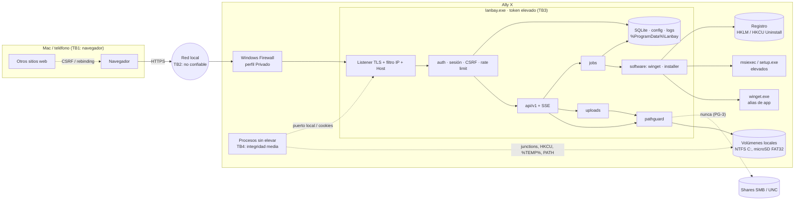

# Modelo de amenazas de Lanbay

**Estado:** propuesto (2026-11-18), JCB-459. **Revisión:** al cerrar M1, M2, M4, M5 y M6, y siempre que cambie una frontera de confianza (nuevo listener, nuevo proceso hijo, nueva dependencia, cambio de contexto de ejecución).

Fuentes: PRD (adjunto de JCB-451), ADR-001…ADR-007. Las marcas **[VERIFICAR]** son supuestos sobre el comportamiento de Windows que hay que confirmar en la Ally, desde la tarea de ADR-004, antes de cerrar el hito que los usa.

## 1. Resumen para decidir

- **Autenticarse en Lanbay equivale a ser administrador de la Ally.** El proceso corre elevado (ADR-004), escribe en casi cualquier ruta e instala software. La contraseña y la sesión son **la** frontera de seguridad. `pathguard` y las zonas protegidas evitan accidentes y cortan ataques locales, pero no limitan al usuario autenticado.
- Hay dos clases de atacante que importan de verdad:
  1. **Un equipo en la misma red.** La Ally es portátil: un hotel, un campus o un Wi-Fi público también usan RFC1918, y el filtro de IP no distingue la red de casa de una red hostil.
  2. **Código sin elevar en la propia Ally** (un mod, un juego o un instalador comprometido). Puede usar Lanbay como **bypass de UAC** si el proceso elevado sigue junctions creados por el usuario, ejecuta binarios de rutas que el usuario puede escribir o confía en claves `HKCU`.
- Las mitigaciones están en el catálogo de controles (§6). Cada control tiene un ID, una verificación concreta y un hito. §7 los agrupa como criterios de aceptación de M1–M6.
- Propongo seis desviaciones del PRD (§9). La más importante: **la contraseña inicial no debe escribirse en el log**.

## 2. Activos

| ID | Activo | Por qué importa |
|---|---|---|
| A1 | Integridad de Windows y del software instalado | El proceso elevado puede reemplazar binarios del sistema o instalar persistencia |
| A2 | Archivos del usuario en todos los volúmenes locales (incluida la microSD) | Confidencialidad (documentos, partidas guardadas, claves) e integridad (borrado permanente en FAT32, ADR-007) |
| A3 | Capacidad de ejecutar instaladores elevados | Es ejecución de código como administrador, por diseño |
| A4 | Credencial del administrador: hash, contraseña inicial y sesiones | Da A1–A3 |
| A5 | Clave privada TLS | Permite suplantar el panel y capturar la contraseña |
| A6 | Directorio de datos `%ProgramData%\Lanbay` (config, SQLite, staging, logs) y el binario `lanbay.exe` | Quien los modifica controla el proceso elevado en el siguiente arranque |
| A7 | Credenciales NTLM del usuario | Se filtran si el proceso abre una ruta que resuelve a SMB |
| A8 | Disponibilidad de la Ally para jugar | Escaneos, subidas y DoS no deben afectar a los juegos |
| A9 | Cadena de suministro: repo, CI, dependencias y release | Un artefacto comprometido corre elevado en cada Ally |

## 3. Actores de amenaza

| ID | Actor | Capacidad | Probabilidad |
|---|---|---|---|
| T1 | Equipo en la misma LAN, sin credenciales | Llega a `:8443`, puede hacer ARP spoofing y MITM, fuerza bruta, DoS | Media en casa; **alta** en redes compartidas |
| T2 | Sitio web malicioso abierto en el navegador del Mac o del teléfono | CSRF, DNS rebinding, clickjacking, contenido servido por el panel | Media |
| T3 | Proceso sin elevar (integridad media) en la Ally, o un archivo plantado por él | Escribe en el perfil, en `HKCU`, en `%LOCALAPPDATA%`, en `%TEMP%` y en volúmenes NTFS (junctions). Puede leer las cookies del navegador de la Ally y escuchar en puertos altos | Media (mods y descargas de juegos) |
| T4 | Contenido hostil: un instalador o paquete winget, un nombre de archivo o un MSI manipulado, un USB NTFS con junctions | Controla datos que Lanbay interpreta | Media |
| T5 | Compromiso de una dependencia npm o Go, de una GitHub Action o de la cuenta del mantenedor | Código dentro del binario elevado | Baja, pero de impacto crítico |
| T6 | Acceso físico a la Ally desbloqueada | Ya es el usuario; con robo, lectura offline del disco | Baja |

Fuera de alcance: un atacante que ya es administrador o SYSTEM en la Ally, y la exposición a internet (no-objetivo del PRD; aquí se trata como un fallo que hay que impedir).

## 4. Diagrama de flujo de datos y fronteras de confianza

| Frontera | Qué cruza | Regla |
|---|---|---|
| TB1 navegador ↔ panel | Peticiones HTTP, cookies, contenido de archivos | El navegador mezcla orígenes: el panel no debe ejecutar contenido servido desde el disco ni aceptar peticiones de otro origen |
| TB2 red ↔ listener | TCP desde cualquier equipo de la red | Solo TLS; filtro de IP antes del handshake; nada sin sesión salvo login y estáticos |
| TB3 proceso elevado ↔ sistema de archivos y procesos hijos | Rutas, ejecutables, argumentos, variables de entorno | Toda ruta pasa por `pathguard`; todo ejecutable va por ruta absoluta verificada; nunca hay shell |
| TB4 integridad media ↔ elevado | Junctions, `HKCU`, `%TEMP%`, `PATH`, puertos, cookies | Nada que T3 pueda escribir decide qué ejecuta o qué toca el proceso elevado |

## 5. STRIDE por componente

Severidad = impacto × probabilidad, después de aplicar el diseño del PRD y **antes** de los controles de §6. Los controles de la última columna la reducen.

### 5.1 Listener de red, TLS y filtro de IP (M1, M6)

| ID | STRIDE | Escenario | Severidad | Controles |
|---|---|---|---|---|
| N1 | S | T1 hace ARP spoofing y presenta su propio certificado en el primer acceso. El usuario ya está acostumbrado a aceptar el aviso del autofirmado, así que entrega la contraseña | Alta | NET-5, AUTH-1, R5 |
| N2 | I | Queda un listener HTTP en claro (hoy `cmd/lanbay` escucha en `:8080` sin TLS) y la contraseña o la cookie viajan sin cifrar | Alta | NET-1 |
| N3 | E | La Ally está en una red compartida (hotel, campus) marcada como Privada. Para el filtro, cualquier equipo con IP RFC1918 es "LAN" | Alta | NET-3, NET-8, AUTH-5, R2 |
| N4 | E | `100.64/10` está permitido por defecto. Con Tailscale, entra **cualquier** nodo del tailnet, incluidos los compartidos; sin Tailscale, el rango también lo usan redes CGNAT de operadores | Media | NET-3 |
| N5 | S | El filtro lee `X-Forwarded-For` o compara mal una IPv4 mapeada en IPv6 (`::ffff:8.8.8.8`) | Alta | NET-2 |
| N6 | S/E | DNS rebinding: un sitio hace que `evil.example` resuelva a la IP de la Ally y el navegador del Mac envía las peticiones desde una IP de la LAN | Media | NET-4, AUTH-4 |
| N7 | D | Slowloris, cabeceras enormes o miles de conexiones desde la LAN dejan el panel sin servicio o roban CPU a los juegos | Baja | NET-6 |
| N8 | S | T3 escucha en `:8443` antes de que arranque Lanbay (o lo comparte con `SO_REUSEADDR`) y suplanta el panel | Media | PROC-2, NET-5 |
| N9 | I | Una IPv6 global de la Ally queda accesible desde internet porque el router no filtra IPv6 entrante | Media | NET-2, NET-3, NET-8 |

### 5.2 Autenticación, sesión y CSRF (M1)

| ID | STRIDE | Escenario | Severidad | Controles |
|---|---|---|---|---|
| AU1 | I | La contraseña inicial queda en el log. La tarea es oculta (ADR-004), así que "imprimir en consola" no tiene consola, y el log persiste en disco y en copias o capturas | Alta | AUTH-1, DAT-3 |
| AU2 | E | Carrera del primer arranque: si existe un endpoint de "configurar contraseña" sin autenticar, el primer equipo de la LAN que lo llame se queda con el panel | Crítica | AUTH-1 |
| AU3 | S | Fuerza bruta desde varias IPs (IPv6 temporales, varios equipos) para saltarse el límite por IP | Media | AUTH-5, AUTH-2 |
| AU4 | D | Cada intento de login cuesta 19–64 MiB de argon2id; muchos intentos concurrentes agotan la RAM (presupuesto de reposo: menos de 50 MB) | Media | AUTH-2, AUTH-5 |
| AU5 | S | Fijación o robo de sesión: token predecible, guardado en claro en SQLite o que sobrevive al cambio de contraseña | Alta | AUTH-3 |
| AU6 | T/E | CSRF desde otro sitio: un `POST` para instalar o borrar. Incluye un `GET` que cambia estado y el CSRF de login | Alta | AUTH-4 |
| AU7 | E | T3 roba la cookie del navegador de la Ally, o usa una sesión abierta por loopback, y la convierte en ejecución elevada (bypass de UAC) | Media | AUTH-6, R7 |
| AU8 | T | El usuario autenticado, o un CSRF, amplía la lista de IPs permitidas o quita zonas protegidas desde la UI | Media | AUTH-7 |
| AU9 | R | No queda rastro de logins fallidos ni de acciones destructivas | Baja | DAT-3 |

### 5.3 Interfaz web y contenido servido (M1, M2, P1)

| ID | STRIDE | Escenario | Severidad | Controles |
|---|---|---|---|---|
| UI1 | E | **XSS almacenado vía disco.** Un `.html` o `.svg` en la Ally (de un mod o de T3) se descarga o previsualiza **en el origen del panel**, ejecuta JS, lee el token CSRF e instala software elevado | Crítica | UI-2, NET-7 |
| UI2 | E | Nombres de archivo, `DisplayName` del registro o salida de winget se renderizan como HTML (`{@html}`) | Alta | UI-1, NET-7 |
| UI3 | T | Clickjacking: otro sitio enmarca el panel y engaña al usuario para que confirme un borrado | Media | NET-7 |
| UI4 | I | Stack traces o rutas internas en los errores | Baja | UI-3 |

### 5.4 Archivos y `pathguard` (M2)

| ID | STRIDE | Escenario | Severidad | Controles |
|---|---|---|---|---|
| PG1 | T/E | Evasión léxica: `..`, UNC (`\\srv\x`, `//srv/x`, `\\?\UNC\`), prefijos de dispositivo (`\\.\`, `\\?\GLOBALROOT`, `\??\`), GUID de volumen, nombres reservados (`NUL.txt`, `COM¹`), ADS (`::$DATA`, `::$INDEX_ALLOCATION`), punto o espacio final (`C:\Windows.`), 8.3 (`PROGRA~1`), mayúsculas y barras mezcladas | Crítica | PG-1, PG-5, PG-8 |
| PG2 | I | **Fuga de NTLM:** un junction o symlink dentro de un volumen local apunta a `\\atacante\x`. Solo con abrirlo, Windows se autentica por SMB y entrega el hash NetNTLMv2 del usuario. Resolver con `GetFinalPathNameByHandle` **después** de abrir llega tarde | Alta | PG-3 |
| PG3 | E | **TOCTOU:** T3 cambia un directorio por un junction a `C:\Windows\System32` entre la validación y la operación. El proceso elevado borra o escribe donde T3 no puede. Es un bypass de UAC clásico | Alta | PG-4, PG-6, R3 |
| PG4 | E | Un USB NTFS trae junctions con destinos absolutos (`C:\Windows`) | Media | PG-3, PG-5 |
| PG5 | T | Un hardlink en una carpeta del usuario apunta a un archivo protegido; sobrescribirlo "en sitio" modifica el original | Media | PG-5, UP-2 |
| PG6 | T | Comparación de prefijo sin límite de componente (`C:\Program Files` contra `C:\Program Files (x86)`) o con `EqualFold`, que no coincide con la tabla de mayúsculas de NTFS | Media | PG-5 |
| PG7 | T | Un handler llama a `os.Remove` o `os.Rename` sin pasar por `pathguard` | Alta | PG-7 |
| PG8 | T/D | Mover **desde** una zona protegida (borra el origen), operar sobre la raíz del volumen o borrar el directorio de datos de Lanbay | Alta | PG-5 |
| PG9 | D | Borrado permanente inesperado en la microSD FAT32 (ADR-007) | Media | ADR-007 (`recycle_unavailable` en el servidor) |
| PG10 | I | Un placeholder de OneDrive (reparse `IO_REPARSE_TAG_CLOUD_*`) se descarga de la nube al listarlo o leerlo | Baja | PG-3 (documentado como lectura) |

### 5.5 Subidas reanudables (M3)

| ID | STRIDE | Escenario | Severidad | Controles |
|---|---|---|---|---|
| U1 | T/E | La ruta relativa de una carpeta subida (`webkitRelativePath`, `../../Windows/x`) escapa del destino validado | Crítica | UP-1 |
| U2 | E | El destino se valida al crear la sesión de subida, pero entre medias T3 lo cambia por un junction antes del rename final | Alta | UP-1, UP-2, PG-4 |
| U3 | S | Un ID de subida predecible o no ligado a la sesión permite escribir chunks en la subida de otro | Media | UP-1 |
| U4 | D | Sesiones abandonadas o tamaños declarados falsos llenan el disco | Media | UP-2, UP-4 |
| U5 | E | Un `.exe` subido no lleva Mark-of-the-Web. Si alguien lo abre luego en la Ally, SmartScreen y Smart App Control no lo revisan | Baja | UP-3 |

### 5.6 Jobs y SSE (M3–M5)

| ID | STRIDE | Escenario | Severidad | Controles |
|---|---|---|---|---|
| J1 | I | SSE sigue emitiendo después de cerrar sesión o de cambiar la contraseña | Media | JOB-1 |
| J2 | D | Un instalador cuelga la cola o deja procesos huérfanos | Baja | JOB-1, INS-7 |
| J3 | I | Los logs de jobs guardan secretos o argumentos sensibles | Baja | DAT-3 |

### 5.7 winget (M4)

| ID | STRIDE | Escenario | Severidad | Controles |
|---|---|---|---|---|
| W1 | E | **Secuestro del ejecutable:** el proceso elevado busca `winget` en `PATH`. El alias vive en `%LOCALAPPDATA%\Microsoft\WindowsApps`, que T3 puede escribir, igual que cualquier directorio de usuario en `PATH` | Alta | SW-1 |
| W2 | E | Inyección de argumentos: un id o una búsqueda como `7zip --override "..."`, `--ignore-security-hash` o `--source msstore` | Alta | SW-2 |
| W3 | T | winget acepta instaladores con hash distinto del manifiesto (`InstallerHashOverride`) o se cambia el source `winget` | Media | SW-3 |
| W4 | E | La API acepta un id libre en `upgrade` o `uninstall` y toca apps no gestionadas, en contra de ADR-001 | Media | SW-4 |
| W5 | T | El parser de `list` falla y se interpreta como "no instalado", así que el panel instala encima de una app preexistente | Media | SW-5 |
| W6 | E | El instalador de un paquete winget es código de terceros que corre como administrador | Media (aceptado) | R6 |

### 5.8 Instaladores subidos (M5)

| ID | STRIDE | Escenario | Severidad | Controles |
|---|---|---|---|---|
| I1 | T | TOCTOU entre la comprobación de Authenticode o del SHA-256 y la ejecución: T3 reemplaza el archivo en staging | Alta | INS-1, INS-2 |
| I2 | S | Una firma inválida o manipulada se presenta como "sin firmar" (solo un aviso), o el nombre del firmante se falsifica en la UI | Media | INS-3 |
| I3 | E | Inyección en la línea de comandos a través del nombre del archivo subido o de un `ProductCode` manipulado dentro del MSI (`{GUID} TRANSFORMS=…`) | Alta | INS-4 |
| I4 | E | **Bypass de UAC por `HKCU`:** T3 edita el `UninstallString` de una app gestionada que vive en `HKCU`, o reemplaza un desinstalador que está en `%LOCALAPPDATA%`. El usuario pulsa "Desinstalar" y Lanbay lo ejecuta elevado | Alta | INS-5 |
| I5 | E | Planting de DLL en `%TEMP%`: los instaladores elevados extraen en el `%TEMP%` del usuario, que T3 puede escribir | Media | INS-7, SW-1 |
| I6 | T | El diff del registro atribuye a Lanbay una clave de otra instalación concurrente | Baja | INS-6 |
| I7 | E | El modo interactivo muestra la UI de un instalador elevado en la pantalla de la Ally; quien la tenga en las manos puede abrir diálogos (por ejemplo, "Examinar") | Baja (aceptado) | R9 |
| I8 | D | El instalador reinicia el equipo | Baja | INS-7 |

### 5.9 Datos en reposo, configuración y logs (M1, M6)

| ID | STRIDE | Escenario | Severidad | Controles |
|---|---|---|---|---|
| D1 | E | **Squatting de `%ProgramData%\Lanbay`:** por defecto `Users` puede crear carpetas en `ProgramData`. Si T3 crea `Lanbay` antes de la instalación, es su propietario y planta config, certificado o base de datos | Alta | DAT-1 |
| D2 | E | `lanbay.exe` vive en una ruta que el usuario puede escribir (Descargas, Escritorio) y la tarea elevada lo ejecuta en cada inicio de sesión | Alta | DAT-2 |
| D3 | I | La clave TLS, la base de datos o los logs se pueden leer sin elevar | Media | DAT-1, DAT-4 |
| D4 | I | Los logs contienen la contraseña, tokens, cookies o el token CSRF | Media | DAT-3 |
| D5 | T | Inyección en el log con nombres de archivo que llevan saltos de línea | Baja | DAT-3 |
| D6 | I | Un portátil robado sin cifrado de disco expone la base de datos y los archivos | Baja | R11 |
| D7 | I | Los logs de auditoría (con rutas personales) crecen sin límite de tamaño ni de tiempo | Baja | DAT-3 |

### 5.10 Contexto de ejecución, instalación y desinstalación (M1, M6)

| ID | STRIDE | Escenario | Severidad | Controles |
|---|---|---|---|---|
| X1 | E | El proceso elevado carga una DLL desde el directorio de la aplicación o desde `PATH` | Media | PROC-1 |
| X2 | E | La tarea programada apunta a una ruta sin comillas o que el usuario puede escribir | Alta | DAT-2 |
| X3 | T | `uninstall` deja la regla de firewall o la tarea huérfanas | Baja | DAT-5 |

### 5.11 Cadena de suministro y release (todos los hitos)

| ID | STRIDE | Escenario | Severidad | Controles |
|---|---|---|---|---|
| S1 | T/E | Un paquete npm comprometido (Svelte, Vite y sus transitivos) mete JS en el bundle embebido; ese JS controla el panel elevado | Alta | SC-2, SC-3 |
| S2 | T | Alguien hace commit de un `internal/web/dist` distinto de lo que produce el código fuente. Hoy CI compila el frontend, pero **no compara** el resultado con el bundle del repo | Alta | SC-3 |
| S3 | T | Una dependencia Go o una herramienta de CI sin fijar (`staticcheck@latest`, acciones por etiqueta `@v4`) | Media | SC-1, SC-4 |
| S4 | S | Un binario troyanizado se distribuye como `lanbay.exe`. Sin firma, el usuario no tiene cómo distinguirlo | Media | SC-5, R4 |
| S5 | T | Un push directo a `main` o un cambio de la rama por defecto. Hoy `origin/HEAD` apunta a `jcb-455-m0-spikes`, no a `main` | Media | SC-6 |
| S6 | T | El kit de M0 se sirve con `irm http://… \| iex`: el hash fijado protege el zip, pero no `bootstrap.ps1` | Baja (solo M0) | SC-7 |

## 6. Catálogo de controles

Cada control es **verificable**: la columna "Verificación" dice qué test o qué evidencia lo demuestra. "Ally" significa evidencia capturada en la Ally desde la tarea de ADR-004.

### NET — red y TLS

| ID | Control | Verificación | Hito |
|---|---|---|---|
| NET-1 | Un único listener, **solo TLS**. Se elimina el servidor HTTP de desarrollo en `:8080`. No existe redirección HTTP→HTTPS en otro puerto | Test: el servidor arranca solo con `TLSConfig`. Ally: `curl http://<ally>:8443` falla y no hay otros puertos de Lanbay (`Get-NetTCPConnection -OwningProcess`) | M1 |
| NET-2 | El filtro de IP actúa en `Accept`, **antes del handshake TLS**, sobre la IP del par TCP: `netip.Addr` con `Unmap()`. Nunca lee `X-Forwarded-For`, `Forwarded` ni `X-Real-IP` | Test de tabla: `::ffff:8.8.8.8` se rechaza, `::ffff:192.168.1.5` se acepta, una IPv6 global se rechaza y las cabeceras de proxy se ignoran | M1 |
| NET-3 | Lista por defecto: loopback, RFC1918, link-local (`169.254/16`, `fe80::/10`) y ULA (`fc00::/7`). **`100.64/10` desactivado por defecto**; se activa con una opción explícita de configuración, documentada para Tailscale. La lista solo se puede ampliar desde el archivo de configuración, nunca desde la UI (AUTH-7) | Test de la configuración por defecto. Test de que `100.64.0.1` se rechaza sin la opción | M1 |
| NET-4 | Lista de `Host` permitidos: `localhost`, el hostname, `<hostname>.local`, las IPs actuales de la Ally y los nombres configurados. Si no coincide: `421 Misdirected Request` | Test con `Host: evil.example` → 421 | M1 |
| NET-5 | Certificado autofirmado ECDSA P-256 con SAN de hostname, `<hostname>.local`, `localhost` e IPs, validez ≤ 825 días (límite de Apple). TLS ≥ 1.2. Clave con la ACL de DAT-1. **La huella SHA-256** se imprime en `lanbay install` y en `set-password`, y se muestra en la UI tras el login. El README explica cómo confiar en el certificado en macOS e iOS y cómo comprobar la huella | Test del certificado generado (SAN, curva, validez). Revisión del README | M1 (README en M6) |
| NET-6 | `ReadHeaderTimeout` 10 s, `IdleTimeout` 120 s, `MaxHeaderBytes` 64 KiB, `MaxBytesReader` por endpoint (JSON 1 MiB; chunk ≤ 64 MiB + margen) y un límite de conexiones concurrentes (64 por defecto) | Test de cada límite | M1 (chunks en M3) |
| NET-7 | Cabeceras en todas las respuestas: `Content-Security-Policy: default-src 'self'; script-src 'self'; style-src 'self'; img-src 'self' data: blob:; connect-src 'self'; object-src 'none'; base-uri 'none'; form-action 'self'; frame-ancestors 'none'`, `X-Content-Type-Options: nosniff`, `Referrer-Policy: no-referrer`, `Cross-Origin-Opener-Policy: same-origin`, `Cross-Origin-Resource-Policy: same-origin`, y `Cache-Control: no-store` en `/api` | Test de middleware. El bundle de Vite funciona sin `unsafe-inline` | M1 |
| NET-8 | Regla de firewall entrante: **programa** = ruta de `lanbay.exe` (DAT-2), TCP 8443, **solo el perfil Privado**, `RemoteAddress LocalSubnet` (más `100.64.0.0/10` solo si NET-3 lo activa). El instalador no cambia el perfil de la red. `uninstall` borra la regla | Ally: salida de `Get-NetFirewallRule -DisplayName 'Lanbay*' \| Get-NetFirewallAddressFilter, Get-NetFirewallApplicationFilter` en `docs/manual-test.md`. Con la red en perfil Público, el puerto no responde | M6 |

### AUTH — autenticación y sesión

| ID | Control | Verificación | Hito |
|---|---|---|---|
| AUTH-1 | **No existe ningún endpoint sin autenticar para crear la credencial.** Sin credencial, `lanbay run` no sirve la API (solo una página que dice "ejecuta `lanbay set-password`"). La contraseña inicial tiene ≥ 20 caracteres de `crypto/rand` (≥ 100 bits) y la genera `lanbay install` o `set-password` **en la consola interactiva**. **Nunca** se escribe en el log ni en la salida de la tarea. Si la tarea oculta tuviera que generarla, va solo a `%ProgramData%\Lanbay\initial-password.txt` (ACL de DAT-1) y se borra tras el cambio. Con `must_change` activo, el servidor responde 403 a todo excepto cambiar la contraseña y cerrar sesión | Tests: sin credencial no hay rutas de API; con `must_change` → 403; el log de un primer arranque no contiene la contraseña (DAT-3) | M1 |
| AUTH-2 | argon2id con `golang.org/x/crypto/argon2` (dependencia nueva: se justifica en el ticket y en el README según ADR-002). Formato PHC con los parámetros; mínimo m = 19 MiB, t = 2, p = 1 (OWASP). Semáforo de **2 hashes concurrentes** como máximo. Comparación en tiempo constante. Contraseña de 12 a 256 caracteres. `set-password` lee sin eco desde la consola o stdin, **nunca desde argv** | Tests: formato PHC, semáforo, rechazo de contraseña corta y larga, rehash cuando cambian los parámetros | M1 |
| AUTH-3 | Token de sesión de 32 bytes de `crypto/rand`; SQLite guarda **solo su SHA-256**. Cookie `__Host-lanbay_session; HttpOnly; Secure; SameSite=Strict; Path=/`, sin `Domain`. Inactividad de 12 h (configurable) y caducidad absoluta de 7 días. Token nuevo en cada login. Cambiar la contraseña revoca todas las sesiones. Logout la borra en el servidor | Tests de cada propiedad, con reloj falso | M1 |
| AUTH-4 | Todo `POST`, `PUT`, `PATCH` y `DELETE` exige `X-CSRF-Token` igual al de la sesión (comparación en tiempo constante) **y** un `Origin` igual al host (o `Sec-Fetch-Site: same-origin`). El login también comprueba `Origin`. **Ninguna ruta `GET` cambia estado** | Test que recorre todas las rutas registradas: las mutaciones sin token o con `Origin` ajeno → 403; ninguna ruta `GET` muta | M1 |
| AUTH-5 | Por IP, 5 fallos por minuto con bloqueo progresivo (1, 2, 4… hasta 15 min). Límite **global**: más de 30 fallos en 10 min añade un retraso a todos. Loopback **no** está exento. El limitador se evalúa **antes** del hash. Cada fallo se audita | Tests con reloj falso: por IP, global y que el hash no se calcula si el limitador corta | M1 |
| AUTH-6 | **Re-autenticación** (contraseña en los últimos 10 min) para cambiar la contraseña, cambiar la configuración de red o de seguridad, instalar un instalador subido y usar argumentos personalizados | Test del middleware en M1; aplicado a los endpoints en M5 | M1 / M5 |
| AUTH-7 | La UI no puede quitar zonas protegidas propias, ni el directorio de datos, ni ampliar la lista de IPs. Solo puede **añadir** zonas protegidas | Test de la API de configuración | M1 / M2 |

### UI — frontend y contenido servido

| ID | Control | Verificación | Hito |
|---|---|---|---|
| UI-1 | Prohibido `{@html}`, `innerHTML` y `outerHTML` con datos del servidor. Nombres de archivo, salida de winget, `DisplayName` y logs se muestran como texto | Paso de CI: `grep -rE '\{@html\|innerHTML\|outerHTML' web/src` falla si encuentra algo | M1 |
| UI-2 | Las respuestas con contenido del disco (descarga y previsualización) llevan `Content-Security-Policy: sandbox; default-src 'none'`, `X-Content-Type-Options: nosniff` y `Content-Disposition: attachment`, salvo los tipos de previsualización permitidos. **Nunca** se sirven en línea `text/html`, `image/svg+xml`, `application/xhtml+xml` ni `text/xml`. La previsualización P1 muestra imágenes ráster con `` y texto con `textContent`. SVG, HTML y PDF van como descarga o en un `<iframe sandbox>` sin `allow-scripts` | Test: descargar un `.html` y un `.svg` devuelve `attachment` y `sandbox` | M2 (previsualización en P1) |
| UI-3 | Errores en JSON con un código tipado y un mensaje en español. Sin stack traces | Test de un handler que provoca un panic: 500 con cuerpo genérico | M1 |

### PG — `pathguard` (crítico)

| ID | Control | Verificación | Hito |
|---|---|---|---|
| PG-1 | **Rechazo léxico, antes de tocar el disco.** Se normaliza `/` a `\` y se exige la forma `X:\…`. Se rechazan: `\\` o `//` al inicio, `\\?\`, `\\.\`, `\??\`, `GLOBALROOT`, `Volume{`; componentes `.` y `..`; `:` fuera de la posición 2 (ADS); nombres reservados en cualquier componente, aunque lleven extensión (`CON`, `PRN`, `AUX`, `NUL`, `COM0-9`, `LPT0-9`, `COM¹²³`, `LPT¹²³`, `CONIN$`, `CONOUT$`); punto o espacio al final de un componente; caracteres `U+0000–U+001F` y `<>"\|?*`; más de 32 767 caracteres | Tests de tabla con todos los casos de §5.4 PG1 | M2 |
| PG-2 | La letra debe estar en la lista **actual** de volúmenes de ADR-006 (re-enumerada, sin caché) | Test con un proveedor de volúmenes falso | M2 |
| PG-3 | **Resolución componente a componente sin seguir reparse points a ciegas.** Cada componente se abre con `FILE_FLAG_OPEN_REPARSE_POINT \| FILE_FLAG_BACKUP_SEMANTICS` (o con `NtCreateFile` y `OBJ_DONT_REPARSE` relativo al handle del padre). Si es un reparse point, se lee la etiqueta (`FSCTL_GET_REPARSE_POINT`): solo se siguen `IO_REPARSE_TAG_MOUNT_POINT` e `IO_REPARSE_TAG_SYMLINK` cuyo destino pase PG-1 y PG-2, con un máximo de 8 saltos. Cualquier otro destino (UNC, `\??\UNC\`, dispositivo, volumen no permitido) se rechaza **sin abrirlo**, así que no llega a haber conexión SMB. Las etiquetas `IO_REPARSE_TAG_CLOUD_*` se tratan como archivos. Al final, `GetFinalPathNameByHandle(FILE_NAME_NORMALIZED \| VOLUME_NAME_DOS)` debe empezar por `\\?\X:\` con una letra permitida | Tests en Windows: junction a `\\127.0.0.1\c$` rechazado sin tráfico SMB (contador de conexiones o `Get-SmbConnection` vacío). Junction local permitido. Bucle de junctions cortado | M2 |
| PG-4 | **Operar sobre el handle validado, no sobre la ruta.** Lectura y descarga desde ese handle. Rename y move con `SetFileInformationByHandle(FileRenameInfoEx)`, con el padre de destino validado. Borrado permanente con `FileDispositionInfoEx`. Creación con `NtCreateFile` relativo al handle del padre y `OBJ_DONT_REPARSE`. Las APIs que solo aceptan rutas (`IFileOperation` para la Papelera) se documentan como TOCTOU residual (R3) | Test de carrera en Windows: un goroutine alterna un directorio con un junction a una carpeta "canario" protegida mientras se borra o renombra en bucle; el canario nunca cambia | M2 |
| PG-5 | Zonas protegidas resueltas al arrancar con `SHGetKnownFolderPath` y normalizadas con PG-3: Windows, Program Files, Program Files (x86), **todo** `ProgramData` (incluido el directorio de datos), el directorio de `lanbay.exe` (DAT-2), las entradas de sistema de cada raíz y la propia raíz de cada volumen (para mutaciones). La comparación es por componentes y sin distinguir mayúsculas, con `CompareStringOrdinal(…, TRUE)`. Se comprueban **origen y destino** en move, copy y rename. Escribir en un archivo existente con `nNumberOfLinks > 1` se rechaza; sobrescribir siempre es temp + rename | Tests: E5, `C:\Program Files (x86)` contra `C:\Program Files`, `c:\wInDoWs`, `PROGRA~1`, hardlink, mover desde `C:\Windows` | M2 |
| PG-6 | Al arrancar se activa `ProcessRedirectionTrustPolicy` (`EnforceRedirectionTrust`, Windows 11 22H2+) para que el proceso elevado no siga junctions creados por usuarios sin elevar. Si la API no existe, se registra en el log y se continúa. **[VERIFICAR]** en la Ally: que está disponible en la versión instalada y que no rompe junctions legítimos del usuario (si los rompe, se arranca en modo auditoría y se decide por ADR) | Ally: evidencia de `GetProcessMitigationPolicy` y del caso de PG-4 con un junction creado sin elevar | M2 |
| PG-7 | `pathguard` devuelve un tipo opaco (`pathguard.Resolved`) que solo él puede construir, y las operaciones de `files`, `uploads` y `software/installer` lo exigen | Paso de CI: ningún paquete fuera de `internal/pathguard` y `internal/files/fsops` llama a `os.Remove*`, `os.Rename`, `os.Create`, `os.OpenFile`, `os.Mkdir*` ni `windows.CreateFile` (grep con lista de excepciones revisada) | M2 |
| PG-8 | Suite adversarial (PRD §5.4 y casos de este documento): UNC en todas sus formas, `..`, junctions y symlinks a local, a UNC y a dispositivo, GUID de volumen, 8.3, mayúsculas, barras mezcladas, `::$DATA`, `::$INDEX_ALLOCATION`, punto o espacio final, nombres reservados con extensión y con superíndice, hardlink, la carrera de PG-4 y un USB NTFS con junction a `C:\Windows`. QA y Seguridad la revisan | CI (Windows) en verde. Revisión de Seguridad sin críticos | M2 |

### UP — subidas

| ID | Control | Verificación | Hito |
|---|---|---|---|
| UP-1 | ID de subida de 128 bits de `crypto/rand`, ligado a la sesión que la creó. El destino se valida con `pathguard` **al crear la sesión y otra vez al finalizar**. Cada componente de la ruta relativa de una carpeta pasa PG-1 y se une bajo el destino validado | Tests: `../` en la ruta relativa → rechazo; chunk de otra sesión → 404; destino cambiado a junction antes de finalizar → rechazo | M3 |
| UP-2 | El temporal `.lanbay-<id>.part` se crea con `CREATE_NEW` en el directorio de destino, relativo a su handle. El rename final se hace por handle y nunca sobrescribe salvo que lo pida la política de conflictos y el destino no esté protegido. Tamaño declarado ≤ espacio libre − 1 GiB. Se exigen el offset y la longitud. Las sesiones caducadas (24 h) se limpian junto con su temporal | Tests de cada regla | M3 |
| UP-3 | Los archivos subidos reciben Mark-of-the-Web (`Zone.Identifier`, `ZoneId=3`) en los volúmenes que admiten ADS. En FAT32 se omite sin error. **[VERIFICAR]** que MOTW no rompe la instalación silenciosa desde staging; si la rompe, se omite solo en staging | Test en Windows: el archivo subido tiene el ADS. Ally: evidencia con un MSI | M3 (recomendado) |
| UP-4 | Máximo de 8 sesiones de subida activas por sesión de login. Máximo de un chunk en vuelo por subida | Tests | M3 |

### JOB — jobs y SSE

| ID | Control | Verificación | Hito |
|---|---|---|---|
| JOB-1 | Jobs y SSE solo con sesión válida. El stream se cierra cuando la sesión caduca o se revoca (se comprueba al menos cada 60 s). Los procesos hijos van en un Job Object con `JOB_OBJECT_LIMIT_KILL_ON_JOB_CLOSE`, con timeout. Si el panel se reinicia, los jobs en curso pasan a `interrupted` | Tests: revocar la sesión cierra el SSE; cancelar mata el árbol de procesos | M3 / M4 |

### SW — winget

| ID | Control | Verificación | Hito |
|---|---|---|---|
| SW-1 | **Ejecutables por ruta absoluta verificada, nunca por `PATH`.** `msiexec` sale de `GetSystemDirectory`. `winget` se resuelve una sola vez al arrancar: el alias debe ser un reparse point `IO_REPARSE_TAG_APPEXECLINK` del paquete `Microsoft.DesktopAppInstaller_8wekyb3d8bbwe`; si no lo es, el módulo de software se desactiva. Entorno de los hijos: `PATH` = directorios del sistema, `TEMP` y `TMP` = `%ProgramData%\Lanbay\tmp\<job>` (ACL de DAT-1), directorio de trabajo = staging. **[VERIFICAR]** en la Ally: cómo leer el alias desde la tarea elevada | Test en Windows: un `winget.exe` falso al principio del `PATH` del usuario no se ejecuta. Ally: evidencia de la ruta resuelta | M4 |
| SW-2 | `exec.Command` con argv, **nunca** `cmd /c`, `powershell -Command` ni concatenar texto. El id debe cumplir `^[A-Za-z0-9][A-Za-z0-9._+-]{0,127}$`. La búsqueda va como `--query <q>`, con ≤ 128 caracteres, sin caracteres de control y sin `-` inicial. Los flags son una lista fija; el usuario nunca puede añadir `--override`, `--custom`, `--location`, `--ignore-security-hash`, `--force` ni `--source` | Tests con `7zip --override x`, `--ignore-security-hash`, `a&calc`, `a" --source msstore`, `-h` | M4 |
| SW-3 | Al arrancar se comprueba que el source `winget` apunta a `https://cdn.winget.microsoft.com/cache` y que `InstallerHashOverride` y `LocalManifestFiles` están desactivados. Si no, la instalación se desactiva con un error explícito. **[VERIFICAR]** el formato de `winget source export` y `winget settings export` | Fixture real de la Ally y test del parser | M4 (recomendado) |
| SW-4 | `upgrade` y `uninstall` reciben **solo el id interno** de una app gestionada. El id de winget sale de la base de datos, nunca del cliente | Test: un id no gestionado → 404 | M4 |
| SW-5 | La detección de una app preexistente **falla cerrada**: si `winget list` no se puede interpretar, la instalación se rechaza | Test con un fixture irreconocible → rechazo, no instalación | M4 |

### INS — instaladores subidos

| ID | Control | Verificación | Hito |
|---|---|---|---|
| INS-1 | Staging en `%ProgramData%\Lanbay\staging\<id aleatorio>.{msi\|exe}`: zona protegida y ACL de DAT-1. La extensión se valida también por la firma del contenido (`MZ` o OLE CFB). El nombre original solo se muestra (saneado); nunca entra en una línea de comandos | Tests | M5 |
| INS-2 | Desde que se calcula el SHA-256 hasta que termina el proceso del instalador, Lanbay mantiene un handle con `FILE_SHARE_READ` (sin escritura ni borrado compartidos). El hash y `WinVerifyTrust` (`WINTRUST_FILE_INFO.hFile`) se calculan **sobre ese handle** | Test en Windows: sobrescribir el instalador durante el job → violación de uso compartido | M5 |
| INS-3 | Authenticode con `WTD_REVOKE_WHOLECHAIN`. Estados distintos: firmado y válido (sujeto, emisor, huella SHA-256 y sello de tiempo), revocación no comprobable (sin red), **firma inválida o manipulada → bloqueo**, y sin firmar → confirmación tecleada ("instalar sin firma") | Fixtures: binario firmado por Microsoft, el mismo con un byte alterado y uno sin firmar | M5 |
| INS-4 | Las líneas de comandos solo contienen rutas que genera Lanbay (sin espacios ni comillas). `ProductCode` validado con `^\{[0-9A-F]{8}(-[0-9A-F]{4}){3}-[0-9A-F]{12}\}$` antes de `/x`. Los presets son tokens fijos. Los argumentos personalizados se tokenizan en argv (sin `"` ni caracteres de control, ≤ 1 024 caracteres), se escapan con `syscall.EscapeArg` y se muestran tal cual en la confirmación. *Nota:* los argumentos personalizados son, por diseño, instrucciones arbitrarias para un instalador elevado. El control evita que **otros** campos se conviertan en argumentos | Tests con el nombre `a.exe" /D=C:\Windows` y con `ProductCode` `{…} TRANSFORMS=x.mst` | M5 |
| INS-5 | Al instalar se guardan en SQLite la clave, la hive, `QuietUninstallString` / `UninstallString` y el **SHA-256 del ejecutable desinstalador**. Al desinstalar se ejecuta ese snapshot (argv con `CommandLineToArgvW`), no el valor actual del registro. Si el valor actual o el hash del ejecutable cambiaron → rechazo y aviso de manipulación. Las entradas de `HKCU`, o con el desinstalador en una ruta que el usuario puede escribir, se marcan y piden confirmación mostrando el comando | Test: modificar el `UninstallString` de `HKCU` después de instalar → rechazo | M5 |
| INS-6 | El diff solo acepta claves **nuevas**. La cola de jobs está serializada. Con más de una clave nueva, el usuario elige; las de `HKCU` se marcan | Tests del diff (PRD §10) | M5 |
| INS-7 | Los instaladores corren con el entorno de SW-1, en un Job Object, con timeout. `/norestart` siempre que exista. Lanbay **nunca** llama a `InitiateShutdown` ni a `ExitWindowsEx` | Test y grep de CI | M5 |

### DAT — datos en reposo y logs

| ID | Control | Verificación | Hito |
|---|---|---|---|
| DAT-1 | `lanbay install` crea `%ProgramData%\Lanbay` con propietario Administradores y DACL **protegida** (sin herencia): `O:BAD:P(A;OICI;FA;;;SY)(A;OICI;FA;;;BA)`. Si el directorio ya existe con otro propietario o con alguna ACE de escritura para no administradores, **aborta** (squatting). `lanbay run` comprueba al arrancar la ACL del directorio y de la clave, la base de datos y la configuración, y **no arranca** si no coincide | Test del evaluador de ACL con SDDL de ejemplo. Ally: salida de `icacls` en `docs/manual-test.md` | M1 (comprobación) / M6 (`install`) |
| DAT-2 | `lanbay install` se copia a `%ProgramFiles%\Lanbay\lanbay.exe` (escribible solo por administradores). La tarea apunta a esa ruta absoluta y entre comillas. `install` se niega a registrar una tarea que apunte a una ruta que el usuario puede escribir | Ally: XML de la tarea e `icacls` del directorio en `docs/manual-test.md` | M6 |
| DAT-3 | Logs `slog` en JSON (escapa caracteres de control). **Nunca** se registran la contraseña, la contraseña inicial, el token de sesión, el token CSRF, `Cookie` ni `Authorization`. Auditoría: fecha UTC, IP, acción, rutas, resultado e id de job, para logins fallidos y para cada acción que cambia estado. Retención de 90 días y tope de 50 MB con rotación (configurables) | Test de integración: capturar el log durante login, cambio de contraseña, primer arranque y subida, y comprobar que no aparece ninguno de los secretos | M1 |
| DAT-4 | La clave TLS se guarda en `tls\key.pem` dentro del directorio de datos (ACL de DAT-1). Reemplazar el certificado desde la configuración exige que el archivo nuevo cumpla la misma ACL | Test | M1 |
| DAT-5 | `uninstall` siempre borra la tarea y la regla de firewall. Si el usuario elige no conservar los datos, borra el directorio de datos completo (clave, base de datos, logs y staging) | Ally: evidencia antes y después en `docs/manual-test.md` | M6 |

### PROC — proceso

| ID | Control | Verificación | Hito |
|---|---|---|---|
| PROC-1 | Al arrancar se llama a `SetDefaultDllDirectories(LOAD_LIBRARY_SEARCH_SYSTEM32)`. Solo se usa `windows.NewLazySystemDLL` | Paso de CI: `grep -r 'NewLazyDLL(' --include=*.go` vacío | M1 |
| PROC-2 | El listener usa `SO_EXCLUSIVEADDRUSE` (`net.ListenConfig.Control`). Si el puerto está ocupado, Lanbay termina con un error claro, no elige otro puerto | Test en Windows: un segundo listener en el mismo puerto falla | M1 |

### SC — cadena de suministro

| ID | Control | Verificación | Hito |
|---|---|---|---|
| SC-1 | `go.sum` versionado, `-mod=readonly`, sin `GONOSUMDB`, `GOPRIVATE` ni `GOINSECURE` en CI. **`govulncheck ./...` en CI** (bloquea si hay vulnerabilidades alcanzables). Cada dependencia nueva se justifica según ADR-002 | Paso de CI | M1 |
| SC-2 | `npm ci` con lockfile y `npm audit signatures` en CI. Dependabot o Renovate con una antigüedad mínima de 7 días para las versiones nuevas. La versión de Node fijada en CI. **[VERIFICAR]** si `--ignore-scripts` es compatible con esbuild; si lo es, se activa | Pasos de CI | M1 |
| SC-3 | **El bundle embebido es reproducible:** CI compila el frontend y ejecuta `git diff --exit-code -- internal/web/dist`. Un `dist` que no salga del código fuente y del lockfile no se fusiona | Paso de CI | M1 |
| SC-4 | Acciones de terceros fijadas por SHA completo; `staticcheck` fijado a una versión (no `@latest`); `permissions: contents: read` (ya está); Dependabot para `github-actions`; sin `pull_request_target` | Revisión de `ci.yml` | M1 |
| SC-5 | Release desde un tag en GitHub Actions, con `CGO_ENABLED=0 -trimpath -buildvcs=true`. Se publican `SHA256SUMS` y una **attestation de procedencia** (`actions/attest-build-provenance`). El README explica `gh attestation verify lanbay.exe -R danielrigobertojs/lanbay` antes de ejecutar. Firmar el código sigue siendo P2 | Ally: verificación de la attestation en `docs/manual-test.md` | M6 |
| SC-6 | Rama por defecto = `main`. Protección de `main`: PR obligatorio, CI obligatoria y sin force-push. Secret scanning y push protection activados | Captura de la configuración del repo (acción humana) | M1 |
| SC-7 | El kit de M0 (`irm http://… \| iex`) queda **solo para spikes en la red de casa**. No se reutiliza para distribuir Lanbay. Si algún día se reutiliza, `bootstrap.ps1` se sirve por HTTPS o se verifica con un hash comunicado por otro canal | Revisión en M6 | M6 |

## 7. Criterios de seguridad por hito

Cada hito se cierra con los controles listados verificados (test en verde o evidencia de la Ally adjunta) y una revisión de Seguridad sin hallazgos críticos abiertos.

| Hito | Controles obligatorios | Recomendados (no bloquean) | Evidencia en la Ally |
|---|---|---|---|
| **M1** (JCB-460) | NET-1…NET-7, AUTH-1…AUTH-5, AUTH-7, UI-1, UI-3, DAT-1 (comprobación al arrancar), DAT-3, DAT-4, PROC-1, PROC-2, SC-1, SC-3, SC-4, SC-6 | AUTH-6 (middleware), SC-2 | Login desde el Mac contra la Ally con la huella del certificado comprobada; `Host` ajeno → 421 |
| **M2** (JCB-461) | PG-1…PG-5, PG-7, PG-8, UI-2, AUTH-7 (zonas), ADR-007 `recycle_unavailable` | PG-6 | E5; caso de red de ADR-006; junction a UNC sin conexión SMB; junction creado sin elevar con PG-6 |
| **M3** (JCB-462) | UP-1, UP-2, UP-4, JOB-1, NET-6 (chunks) | UP-3 | Subida reanudada tras suspensión sin archivos `.part` huérfanos tras la limpieza |
| **M4** (JCB-463) | SW-1, SW-2, SW-4, SW-5, JOB-1 | SW-3 | Ruta resuelta de winget; un `winget.exe` falso en el `PATH` del usuario no se ejecuta |
| **M5** (JCB-464) | INS-1…INS-7, AUTH-6 en los endpoints de instalación | UP-3 en staging | MSI e Inno Setup (E4) con la ACL de staging; manipulación de `HKCU` rechazada |
| **M6** (JCB-465) | NET-8, DAT-1 (`install`), DAT-2, DAT-5, SC-5, SC-7; README con NET-5 (huella y confianza en macOS/iOS), aviso de binario sin firmar y recomendación de cifrado de dispositivo | — | Salidas de `Get-NetFirewallRule`, `icacls`, XML de la tarea y `gh attestation verify` en `docs/manual-test.md` |

## 8. Riesgos residuales priorizados

Lo que queda después de aplicar §6. Probabilidad e impacto: A (alta), M (media), B (baja).

| # | Riesgo | P | I | Prioridad | Tratamiento propuesto |
|---|---|---|---|---|---|
| R1 | **Credencial comprometida = administrador de la Ally.** Contraseña débil o reutilizada, phishing aprovechando el aviso del certificado, cookie robada del navegador del Mac | M | A | **1** | Aceptado por diseño (PRD: un solo administrador). AUTH-1…AUTH-6 y NET-5 lo reducen. Revisar la necesidad de un segundo factor después del MVP |
| R2 | **Redes no confiables.** En un hotel o un campus marcado como Privado, o en un tailnet con nodos compartidos, el filtro RFC1918 deja pasar a desconocidos | M | A | **2** | NET-3, NET-8 (LocalSubnet) y AUTH-5. Propuesta P1: lista de redes de confianza por identificador de red (NLA) y comprobar la categoría de la interfaz en `Accept`; fuera de ellas, el listener se cierra |
| R3 | **TOCTOU en APIs que solo aceptan rutas** (`IFileOperation` para la Papelera, rutas que reciben `msiexec` o los instaladores) frente a T3 → bypass de UAC | M | A | **3** | PG-4, PG-6, INS-1/INS-2. Si PG-6 no está disponible en la Ally, sube a prioridad 1 para M2 |
| R4 | **Binario sin firmar.** El usuario no distingue un `lanbay.exe` troyanizado y se acostumbra a ignorar SmartScreen | M | A | 4 | SC-5 (attestation y checksums). Firma de código (P2): evaluar Azure Trusted Signing |
| R5 | **TOFU del certificado autofirmado.** El primer acceso se puede interceptar si el usuario no comprueba la huella | M | M | 5 | NET-5. Alternativa post-MVP: una CA local con *name constraints* que se instala una sola vez en el Mac y el teléfono |
| R6 | **Software de terceros como administrador** (winget e instaladores subidos). Authenticode solo informa; la protección real es Defender | M | M | 6 | Aceptado por diseño. INS-3 bloquea firmas inválidas; SW-3 mantiene el hash de winget |
| R7 | **Lanbay como escalada para malware sin elevar** que roba la cookie de la Ally o usa loopback | B | A | 7 | AUTH-5 sin excepción para loopback, AUTH-6, INS-5, SW-1, DAT-1, DAT-2. Microsoft no considera UAC una frontera de seguridad, pero aquí la tratamos como tal |
| R8 | **Cadena de suministro npm/Go** dentro del binario elevado | B | A | 8 | SC-1…SC-4. Revisar las actualizaciones de dependencias como cambios de seguridad |
| R9 | La UI de un instalador interactivo elevado queda a la vista de quien tenga la Ally en las manos | B | M | 9 | Aceptado (quien la tiene en las manos ya es el usuario). Si ADR-004 (d) falla, el modo interactivo sale del MVP |
| R10 | La auditoría la puede borrar el propio administrador; no hay evidencia a prueba de manipulación | B | B | 10 | Aceptado para un solo usuario |
| R11 | Robo físico: SQLite, logs y la microSD FAT32 no están cifrados por Lanbay | B | M | 11 | El README recomienda el cifrado de dispositivo o BitLocker. La microSD queda fuera de alcance |
| R12 | Kit de M0 por HTTP | B | M | 12 | SC-7; retirarlo cuando se cierre M0 |
| R13 | DoS desde la LAN | B | B | 13 | NET-6, AUTH-5 |

## 9. Desviaciones del PRD que propongo (requieren decisión)

| # | PRD | Propuesta | Motivo |
|---|---|---|---|
| D1 | §5.1: la contraseña inicial se imprime "en consola y en el log" | Solo en la consola interactiva de `install` o `set-password`; nunca en el log (AUTH-1) | La tarea es oculta (ADR-004), así que el log sería el único destino, y queda en disco (AU1) |
| D2 | §5.1: `100.64/10` permitido por defecto | Desactivado por defecto; opción explícita para Tailscale (NET-3) | El rango incluye nodos compartidos de Tailscale y redes CGNAT de operadores (N4) |
| D3 | §5.1: firewall "solo perfil Privado" | Además `RemoteAddress LocalSubnet` y filtro por programa (NET-8) | Limita el alcance a la subred conectada |
| D4 | §5.5.3: "sin firmar" es una advertencia | Firma **inválida** → bloqueo; sin firmar → confirmación tecleada (INS-3) | Una firma rota indica manipulación, no ausencia de firma |
| D5 | ADR-002: lista cerrada de dependencias | Añadir `golang.org/x/crypto` (argon2id) | El PRD exige argon2id y la stdlib no lo trae |
| D6 | — | Re-autenticación para acciones de máximo impacto (AUTH-6) | Reduce R1 y R7 sin cambiar el modelo de un solo usuario |

Si alguna se rechaza, el control afectado se marca como riesgo aceptado en §8, con la decisión y su fecha.

## 10. Mantenimiento

- Cada hito de §7 enlaza este documento y lista los IDs de control que cierra.
- Un hallazgo nuevo recibe un ID en §5, uno o más controles en §6 y, si no se mitiga del todo, una fila en §8.
- Los **[VERIFICAR]** pasan a hechos con la ruta de la evidencia en `docs/spikes/results/` o en `docs/manual-test.md`.
